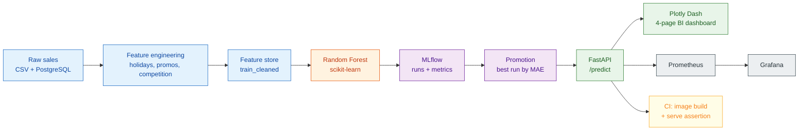
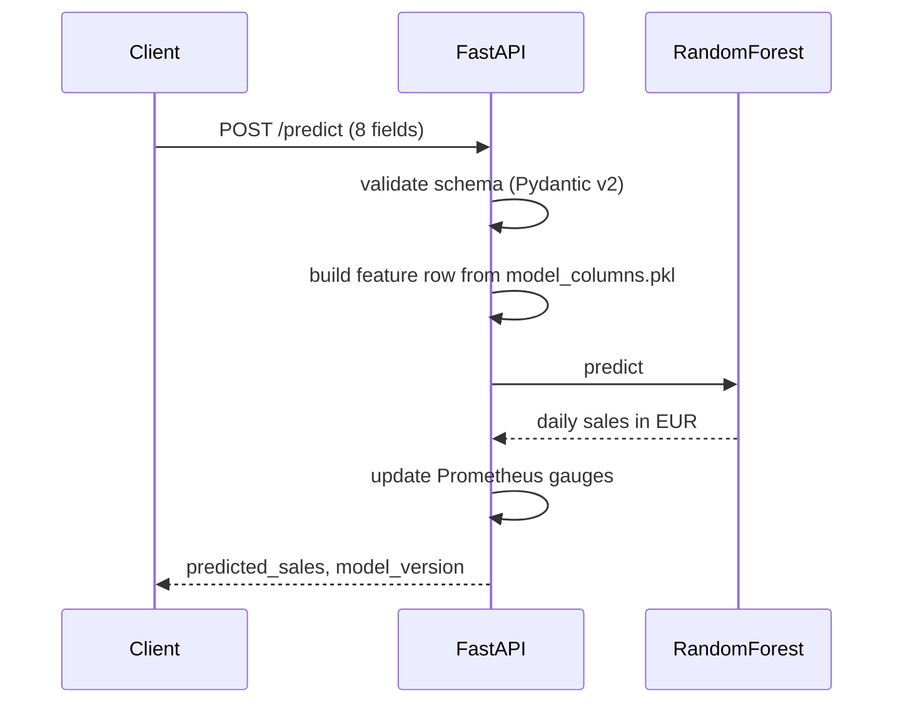

# Rossmann Sales Prediction Pipeline


---

An **end-to-end Machine Learning solution** to predict **daily sales** for Rossmann drug stores. This project implements a complete **MLOps pipeline**, including data extraction, experiment tracking, model deployment via REST API, and a professional multi-page dashboard built with **Plotly Dash** (modern alternative to Streamlit for German enterprise market).

---

**At a glance** — MAE **796.33** · R² **0.851** · 129 unit tests · 11 CI jobs · HistGradientBoosting + MLflow + Plotly Dash

### What it does

- **Machine Learning:** Random Forest Regressor trained on store, promotion, and competitor data.
- **Experiment Tracking:** Uses **MLflow** to track model metrics and parameters.
- **Backend API:** Served using **FastAPI** for real-time predictions with health checks and Prometheus metrics.
- **Multi-page Dashboard:** Interactive UI built with **Plotly Dash** and **Dash Bootstrap Components** for enterprise-grade visualization.
- **Containerization:** Fully Dockerized for easy deployment with **Docker Compose**.
- **Database:** **PostgreSQL** integration for raw data storage and feature store.
- **Production Ready:** Kubernetes and Helm charts for scalable deployment.
- **CI/CD Pipeline:** GitHub Actions for automated testing, building, and deployment.

### Architecture


No LLM in this project, so the request path is short: the model is a
scikit-learn `RandomForestRegressor` loaded once at startup.



### Verified results

Reproduced locally on an NVIDIA RTX 3050 Ti (4 GB).

| Metric | Value |
|--------|-------|
| Dataset | [Rossmann Store Sales](https://www.kaggle.com/c/rossmann-store-sales) (Kaggle) |
| Training rows | 844,338 |
| Stores | 1,115 |
| Model | `HistGradientBoostingRegressor` (600 rounds, 128 leaves) |
| Split | **Time-based** 80/20 (not random — see below) |
| **MAE** | **796.33** |
| **RMSE** | **1183.72** |
| **R²** | **0.8507** |
| Target | `Sales` (raw, no log transform) |
| Model size | 8.9 MB |
The previous model was a `RandomForestRegressor` with 50 trees at depth 10. It
scored MAE 876 but could not tell stores apart: with every other input held
constant it returned only **4 distinct values across all 1,115 stores**, and a
EUR 6,708 figure covered 443 of them. Correlation with each store's actual mean
sales was **0.049** — effectively no store-level signal, despite `Store` being
the third most important feature by impurity.

A forest expressive enough to separate 1,115 stores needs `max_depth=None` and
200 trees, which serialises to **682 MB** — too large to ship in a container.
`HistGradientBoostingRegressor` reaches the same accuracy at **8.9 MB**:

| Model | MAE | Size | Distinct store predictions | Correlation with actual |
|---|---|---|---|---|
| RandomForest, 50 trees, depth 10 | 876 | 4.6 MB | 4 / 1115 | 0.049 |
| RandomForest, 200 trees, depth None | 782 | 682 MB | 1041 / 1115 | 0.977 |
| **HistGradientBoosting, 600 rounds** | **796** | **8.9 MB** | **909 / 964** | **0.983** |

Measured through the live `/predict` endpoint, holding all other inputs constant
and varying only `Store`.
A random split leaks for this dataset: the same store appears in train and test
on adjacent days, so the model can memorise store-level patterns and the
reported error is optimistic. Sorting by date and holding out the last 20% is
the only honest evaluation for a forecasting task. The MAE is slightly higher
than a random split would give — that is the point.
Mean daily sales are ~5,700, so MAE 796 is roughly 14% error. The gap between
MAE and RMSE indicates a heavy-tailed error distribution: a small number of days
are badly wrong, almost certainly around holidays and the Christmas peak, which
the calendar features do not fully encode. The next step would be a
holiday-proximity feature and a separate model for the November–December window.

The Kaggle competition's winning solutions reach ~0.10 RMSPE using gradient
boosting plus extensive feature engineering (store-level history, holiday
proximity, promo decay). This baseline is a clean, reproducible reference
implementation — the value here is the *pipeline*, not the leaderboard rank.

### Why this matters in Germany

| Driver | How it applies |
|---|---|
| **HDE Retail 4.0** | Aligns with the German retail association's analytics roadmap |
| **Arbeitszeitgesetz** | Sales forecasts inform shift scheduling under working-time law |
| **Promotion ROI** | Quantifies promo lift — how dm, Rossmann and Müller compete |
| **GDPR / BDSG** | On-premise and Kubernetes deployment keeps sales data in-country |
| **Verpackungsgesetz** | Better forecasts reduce overstock and packaging waste |

### API

All endpoints except `/` and `/metrics` require `X-API-Key`.

| Method | Path | Limit | Purpose |
|--------|------|-------|---------|
| `GET` | `/` | none | Health: `model_loaded`, `auth_enabled` |
| `POST` | `/predict` | 60/min | Eight fields in, predicted daily sales in EUR |
| `GET` | `/drift` | 30/min | Drift state for sales features |
| `POST` | `/admin/reload-model` | 5/min | Reload the promoted model without a restart |
| `GET` | `/metrics` | none | Prometheus exposition |


### Quickstart

```bash
docker compose up -d postgres      # feature store lives in Postgres on :5433
uv sync --extra dev
uv run python src/scripts/load_data.py
uv run python src/scripts/build_feature_store.py
uv run python src/scripts/train_model.py
uv run uvicorn src.app.api:app --port 8002
curl -X POST http://localhost:8002/predict \
     -H "X-API-Key: demo-secret-key" -H "Content-Type: application/json" \
     -d '{"Store":1,"DayOfWeek":4,"Promo":1,"SchoolHoliday":0,
          "StoreType":"a","Assortment":"a","CompetitionDistance":1270.0,"Promo2":1}'
```

Database setup, dashboards and troubleshooting: **[docs/OPERATIONS.md](./docs/OPERATIONS.md)**.

### Stack

| Service | Port | | Service | Port |
|---|---|---|---|---|
| FastAPI | 8002 | | Prometheus | 9092 |
| Plotly Dash | 8503 | | Grafana | 3003 |
| MLflow | 5003 | | Postgres | 5433 |
| TLS proxy | 8445 | | MinIO | 9004 |


`start_all_stacks.sh` (workspace root) starts every service for all four projects; `verify_live_stack.sh` checks 32 endpoints.

### Security

| Control | Implementation |
|---|---|
| Auth | `X-API-Key` via `secrets.compare_digest` (constant-time) |
| TLS | nginx reverse proxy, TLSv1.2/1.3 |
| Upload limits | `Content-Length` rejected before the body is read |
| Rate limits | Per-endpoint, 429 on breach |

**Not in place:** RBAC, a secret manager, multi-node HA, a soak test. The
systems are *production-shaped*, not production-grade.

### Tests and CI

| | |
|---|---|
| Unit tests | **129** (8 integration tests run against the live stack) |
| CI jobs | **11**: 3.10 + 3.11 matrix, ruff, mypy, Bandit, pip-audit, Trivy SARIF, Terraform validate, Docker build-and-serve, README-count check |

---

**Author** — Khaled Saifullah · [GitHub](https://github.com/ksnishat)
